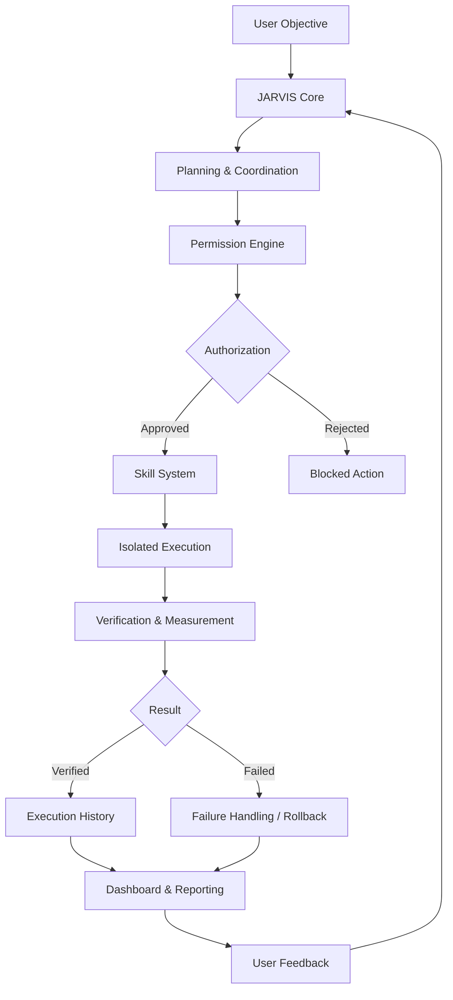

# JARVIS — Your Local AI-Powered Execution Assistant

<p align="center">
  <strong>Think. Plan. Execute. Verify. Improve.</strong>
  <br />
  A modular AI assistant designed to turn user-defined goals into controlled, verifiable actions.
</p>

<p align="center">
  
</p>

---

## Overview

**JARVIS is an experimental local-first AI assistant designed to do more than generate text.**

Instead of acting as a conventional chatbot, JARVIS is built around a different approach: the user defines an objective, provides boundaries and authorizes actions, while the system coordinates capabilities, executes approved tasks, verifies outcomes and maintains an execution history.

The central idea is simple:

> An AI assistant should not just tell you what to do. It should be able to help you do it, prove what happened and recover when something goes wrong.

JARVIS combines an extensible skill system, permission controls, isolated execution, persistent state and verification mechanisms into one modular platform.

It is being developed with a focus on user control, reliability, transparency and continuous improvement.

## Core Principles

| Principle | Approach |
|---|---|
| User Control | Actions are governed by explicit permission levels. |
| Security | Skill execution uses isolation and fail-closed controls. |
| Transparency | Execution history and system events provide visibility. |
| Reliability | Actions and improvements are subject to verification. |
| Recoverability | Update and improvement workflows include rollback mechanisms. |
| Extensibility | Capabilities are organized around an extensible skill system. |
| Local-first | Core application state and execution are designed to run locally. |

## Architecture

JARVIS is organized into independent components responsible for different parts of the execution lifecycle.



### Main Components

**1. AI Integration Layer**

Connects JARVIS to compatible external language-model providers through API integrations. The model provider is separate from the core application.

**2. Permission Engine**

Implements four authorization levels, L1–L4, to govern what actions the system can perform.

The objective is to give the user control over the degree of autonomy rather than treating every AI-generated action as automatically authorized.

**3. Skill Management System**

Provides an extensible mechanism for organizing, managing and executing capabilities.

Skills can be inspected, trusted and executed through the application interface.

**4. Isolated Execution Runtime**

Uses Bubblewrap (`bwrap`) to isolate skill execution.

The runtime is designed to fail closed: execution is blocked when required isolation or authorization checks cannot be satisfied.

**5. Persistent Storage**

Uses SQLite for application state and persistent records, with guarded, additive database migrations.

**6. Verification & Improvement Engine**

Implements a VERIFY/MEASURE approach to improvements.

The system records baseline evidence, evaluates changes and supports footprint-bounded rollback when an improvement fails verification.

**7. Update Management**

Uses staged updates, backups and rollback mechanisms to avoid treating an update as successful before verification.

**8. Dashboard & Event System**

Provides visibility into backend activity, available updates, skills, execution history and skill-management actions.

---

## Features

### Controlled AI Execution

- Four-level permission architecture (L1–L4).
- Authorization-aware skill execution.
- Explicit skill trust management.
- Fail-closed execution gates.

### Isolated Skill Runtime

- Bubblewrap-based execution isolation.
- Execution blocked when isolation requirements fail.
- Controlled skill execution boundaries.
- Designed to reduce the risks associated with unrestricted AI-generated actions.

### Persistent & Recoverable System

- SQLite-backed persistence.
- Guarded database migrations.
- Staged update application.
- Backup and rollback support.
- Evidence-based improvement verification.

### Operational Dashboard

- Backend event visibility.
- Skill management.
- Skill execution history.
- Trust management actions.
- Update visibility and management.

### AI Provider Integration

- API-compatible LLM integration.
- Provider-independent application architecture where supported by adapters.
- External inference through a separately configured model gateway.

---

## Technology Stack

| Category | Technologies |
|---|---|
| Backend | Python |
| Frontend | HTML, CSS, JavaScript |
| Database | SQLite |
| AI Integration | OpenAI-compatible / Anthropic-compatible APIs |
| Execution Isolation | Bubblewrap |
| Testing | Python automated tests, Playwright |
| Development Environment | Linux, Git |

The project follows a lightweight, standard-library-first approach wherever practical.

---

## Getting Started

JARVIS is currently under active development. The following setup describes its Linux development environment. The exact application launcher and configuration steps must match the current repository entry point before a release.

### Requirements

- Linux environment.
- Python 3.
- Git.
- Bubblewrap (`bwrap`).
- SQLite support through Python's `sqlite3` module.
- A compatible LLM API gateway for AI-powered operations.

### 1. Install system dependencies

On Ubuntu, Debian or Linux Mint:

```bash
sudo apt update

sudo apt install -y \
  python3 \
  git \
  bubblewrap
```

Verify the dependencies:

```bash
python3 --version
git --version
bwrap --version

python3 -c "import sqlite3; print('SQLite:', sqlite3.sqlite_version)"
```

### 2. Clone the repository

```bash
git clone https://github.com/YOUR_USERNAME/JARVIS.git

cd JARVIS
```

Replace `YOUR_USERNAME` with the actual GitHub owner.

### 3. Prepare the Python environment

Create a virtual environment:

```bash
python3 -m venv .venv

source .venv/bin/activate
```

Install project dependencies if a `requirements.txt` file is present:

```bash
python -m pip install -r requirements.txt
```

### 4. Configure the AI provider

JARVIS uses an external LLM integration rather than bundling a language model.

Configure a supported API-compatible gateway according to the application's configuration and provider adapter requirements.

For example, the current development environment has used a local gateway with this API base:

```text
http://localhost:3001/v1
```

This endpoint belongs to the separate gateway service, not JARVIS itself. You must have the gateway running and a functioning model configured before expecting AI-powered operations to work.

Never commit API keys or provider credentials.

### 5. Launch JARVIS

Start JARVIS using the application's verified startup entry point from the repository root.

**Note:** Insert the exact startup command here after verifying the current server entry point. Do not assume a script name or launch command.

Once running, open the local dashboard address printed or documented by the application.

---

## How to Use JARVIS

The intended operating workflow is based on controlled execution rather than unrestricted autonomy.

### Step 1 — Define an objective

Give JARVIS a concrete goal.

For example:

```text
Research potential customers for my AI automation service.

Identify relevant businesses, evaluate their websites,
and prepare a report containing business information,
potential automation opportunities and source links.

Do not contact anyone or send messages.
```

The more precise the objective and boundaries, the easier it is to evaluate the result.

### Step 2 — Establish permissions

Choose the appropriate authorization level.

JARVIS uses four permission levels, L1–L4. Consult the application's permission descriptions before authorizing any operation.

Never grant a broader permission level than the task requires.

### Step 3 — Inspect capabilities

Use the skill-management interface to inspect the available capabilities and their trust status.

Only authorize skills you understand and intend to use.

### Step 4 — Execute authorized work

Run the approved capability and monitor the system events and execution history.

The execution runtime applies its authorization and isolation checks before allowing skill execution.

### Step 5 — Verify the outcome

Examine the execution result and available verification evidence.

A successful response from an AI model is not automatically proof that the requested real-world operation succeeded.

### Step 6 — Review and improve

Use the available history, verification and improvement mechanisms to evaluate results.

Improvements and updates should be verified, with rollback mechanisms available when supported operations fail.

---

## Security & Safety

Security is a core design consideration in JARVIS.

The project implements several defensive mechanisms:

- Permission checks before authorized operations.
- Fail-closed skill execution gates.
- Bubblewrap-based process isolation.
- Skill trust management.
- Staged updates and backup-based rollback.
- Verification before accepting improvements.

**Important:** These mechanisms do not constitute a guarantee of complete system security.

JARVIS is experimental software under active development. Its security boundaries have not been independently audited. Do not use it with production credentials, confidential customer information or unrestricted access to critical systems.

Always inspect skills and review permissions before execution.

---

## Testing & Verification

Testing is an important part of the development process.

The latest reported Phase 14B verification run (October 31, 2026) recorded:

| Test suite | Reported result |
|---|---:|
| Python unit tests | 943 / 943 passed |
| Playwright browser tests | 107 / 107 passed |

These are historical development test results, not a claim that every current checkout or future release has been independently verified.

The test suites should be rerun against the exact version being released.

---

## Current Development Status

JARVIS is under active development.

The reported Phase 14B implementation includes:

- Permission engine and skill-management functionality.
- Bubblewrap-isolated skill execution.
- Fail-closed runtime checks.
- Guarded SQLite migrations.
- Verification and measurement of improvements.
- Footprint-bounded rollback.
- Staged updates and backup rollback.
- Backend dashboard endpoints.
- Frontend skill execution, history and trust controls.

### Further Development

- Complete live end-to-end UI validation.
- Improve setup and installation documentation.
- Expand integration and failure-recovery tests.
- Add clearer operational observability.
- Improve deployment and configuration workflows.
- Continue hardening the security model.

---

## Project Philosophy

JARVIS is built around a distinction that matters:

**Intelligence without control is not reliable autonomy.**

A useful AI system needs more than a powerful language model. It needs boundaries, tools, execution controls, verification and the ability to recover from failures.

The long-term objective is to develop an AI assistant that can understand objectives, coordinate capabilities and execute approved work while keeping the user informed and in control.

---

## Disclaimer

JARVIS is an independent experimental software project.

It is provided for development, research and experimentation. It is not currently presented as a production-ready autonomous agent, and it should not be trusted with sensitive or critical operations without independent security review.

---

<p align="center">
  <strong>JARVIS</strong>
  <br />
  <em>From instructions to verified execution.</em>
</p>

<p align="center">
  Built with curiosity, engineering and a focus on controlled AI autonomy.
</p>
